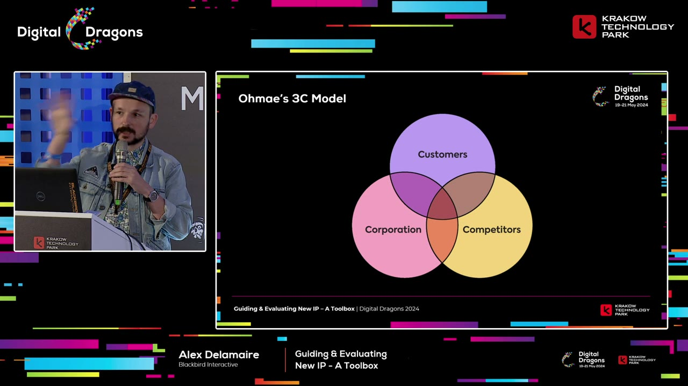
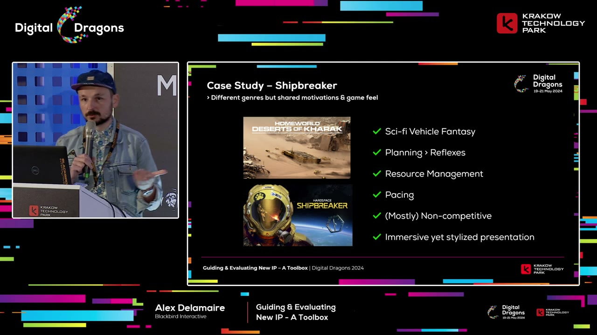

# Finding and Testing New Game IP

Alex Delamaire combines market research, studio identity, and early validation to make original game ideas more deliberate.

Source: [Alex Delamaire - Guiding & Evaluating New IP - A Toolbox](https://www.youtube.com/watch?v=5iwNYRLWjRk) · Digital Dragons · Published 2024-11-15
Video: 51:05 · Reading: ~17 minutes · Basis: captions + 10 inspected snapshots

[Web edition](finding-and-testing-new-game-ip.html)

Topics: Game design · New IP
Generated: November 2026
Processing tokens: Not recorded — Exact per-video model token usage was not recorded during original processing.

## Overview

Alex Delamaire offers a toolbox for developing original game properties rather than a guaranteed sequence for producing a hit. His approach connects three questions: what players want, what the competitive landscape leaves open, and what this team is especially suited to make. Blackbird examples show how that thinking becomes pitches, risk matrices, prototypes, and comparison sets. The aim is to make creative risk visible and testable while preserving the personal reasons a team cares about its idea.

### What the snapshots add

- The inspected 3C and Shipbreaker slides make the connection between market opportunity and studio identity explicit.
- Two matrices show how to turn a speculative concept into risks, experiments, and a qualified comparison set.

## Key takeaways

- **Study unmet needs rather than only today’s winners** Genre revenue describes the present; feedback and changing player motivations can reveal opportunities for a game that will ship years later.
- **Connect novelty, familiarity, and a personal reason** An original property needs a readable proposition and a genuine connection to the team, not just a new label on a familiar product.
- **Break ideas into ingredients before funding the whole vision** Define what each ingredient should achieve, identify its risks, and choose experiments that resolve those uncertainties.

## A toolbox for defining the creative space, not a formula for a hit

Source timestamp: [0:00](https://www.youtube.com/watch?v=5iwNYRLWjRk&t=0s)

Delamaire introduces the talk as a toolbox because original intellectual property is complicated and different projects need different tools. He does not claim a universal method from A to Z. His background is business development, communications, and advertising strategy, with experience connecting business realities, research, and consumer insights to creative teams. That background shapes the kinds of questions he asks.

He recalls working on a BlackBerry campaign aimed at younger people through music. In his view, the communications assignment could not solve a deeper problem in the product's competitive position. The experience made him interested in research that informs what gets made before advertising has to sell it. Marketing at the end of development can only change so much.

He contrasts that with IDEO's shopping-cart design example: observe how people use a product, understand the problems, and then change the design. He describes removable sections for heavy items and a scanner as examples of practical responses to user needs. The relevant lesson for games is the relationship between observation and conception, rather than any claim that designing a cart and designing a game are identical tasks.

Trend research also influenced him, especially work that looks beneath superficial fashions toward changes in behavior and culture. A short-lived trend may offer little substance, while a deeper change can inform both the product and its communication.

His metaphor is setting the perimeter of a sandbox. Designers build the sandcastle; his work helps establish where the team has a reason to believe it can operate and where it begins taking additional risk. Crossing the boundary is not forbidden. Original work requires risk, but the team should understand what risk it is choosing rather than discover it only after committing to production.

## Why new IP remains valuable in a market full of established games

Source timestamp: [8:18](https://www.youtube.com/watch?v=5iwNYRLWjRk&t=498s)

The market picture he describes is discouraging: established and live-service games retain attention, cross-platform availability and backwards compatibility extend their lives, and publishers can use discounts and extra content to keep them commercially active. Familiar franchises and licenses offer an obvious way to reduce some uncertainty. He also points to studio closures and a wider retreat toward existing properties in the period of the talk. These are historical observations and examples, not a current industry report.

At the same time, he cites recent original successes such as Lethal Company and Manor Lords as reasons not to abandon new properties. A difficult market does not erase the possibility of finding an audience. The decision depends on the financial exposure, size of the team, and kind of product being proposed. The existence of hits is encouragement to investigate, not proof that any original concept is safe.

Owning a property also changes what a studio can build over time. He uses a Disney-style business flywheel to describe characters, stories, games, merchandise, and other forms reinforcing one another. A team working only inside someone else's license may benefit from its familiarity without owning those longer-term opportunities.

His examples range from major entertainment franchises to Five Nights at Freddy's and smaller studios building durable relationships around their own games. He argues that a recognizable property and a direct fan relationship can provide stability and options for sequels, expansions, and related experiences. His comments about which Vancouver studios had avoided layoffs are his observations at recording time, not a controlled comparison proving ownership alone protects jobs.

The argument is therefore a tradeoff. Borrowing a familiar license may lower some discovery risk, while building something owned can preserve more future upside and creative control. A studio should consider both the immediate production challenge and the value of the relationship it might establish.

## Look beyond current genre earnings to the gaps players reveal

Source timestamp: [14:29](https://www.youtube.com/watch?v=5iwNYRLWjRk&t=869s)

Genre viability is a useful starting point. Delamaire mentions market-analysis resources that compare median revenue and audience demand, but warns that attractive figures do not describe the whole opportunity. A genre may require production values, budget, and staffing the team cannot supply. It may also have dominant incumbents that make entry unusually difficult.

More importantly, a game begun now may ship four or five years later. Tastes, competitors, and culture will change in between. Copying what currently sells can leave a team responding to yesterday's opportunity. He wants research to help identify what might come next.

For Earthless, Blackbird examined Steam and press reviews of relevant games, categorizing recurring praise and complaints and counting themes. The inspected slide shows positive and negative lists with counts, though the individual small entries are not all legible. The purpose is to identify patterns in player experience rather than cherry-pick a favorable quotation.

He describes using ChatGPT to summarize review themes as a way to reduce manual work and says its output on a recent project was close to what the team had observed itself. This is his account of a particular use, not an independent claim that automated analysis is always accurate. The value he sees is faster access to a possible gap in the market, with empirical familiarity providing a comparison.

His phrase for the opportunity is negative space: look at what existing games do and at the wishes or frustrations around them to infer a shape that is not yet fully present. People may describe an improved version of what they already know—a “faster horse”—without proposing the eventual new product. The creative team still needs to interpret the underlying problem.

## Player motivations can reveal a different kind of cooperative experience

Source timestamp: [18:00](https://www.youtube.com/watch?v=5iwNYRLWjRk&t=1080s)

Motivational frameworks and player personas can help distinguish desires hidden within a broad genre. Delamaire discusses Quantic Foundry alongside a Big Five personality diagram, considering questions such as collaboration versus competition, social interaction, and preferred pacing. He presents these as lenses for noticing unfulfilled aspirations, not rigid categories that fully predict each player's choices.

During the pandemic, Blackbird noticed games becoming social spaces and a form of theatre. GTA roleplay and Among Us suggested that players wanted places to bring their own interactions, stories, and performances, not only mechanics to master. The team interpreted the period's isolation as making that need more visible.

Project Puffin was an exploration of that opportunity. The inspected concept slide identifies third-person cooperative sandbox espionage. Delamaire describes a multiplayer Hitman-style proposition with a colorful crew: friends enter an open location, split up to explore, discover opportunities and optional rewards, and discuss how to accomplish shared objectives.

The interesting tension comes from communication and improvisation. A heist-film moment in which everyone pretends to be ordinary while coordinating privately is a reference point. The game should reward analyzing a situation, agreeing on a plan, and recovering when it goes wrong, rather than simply shooting faster. A vault could bring the group together while one person distracts guards and others carry out the break-in.

He emphasizes brains over reflexes and a spectrum of failure from which players can recover. The social experience and the action systems are meant to support the same fantasy. At the time of the talk, he says the project is on pause. It is offered as a development example of translating a perceived audience need into a concept, not as an announced commercial outcome.

## Consider the wider culture without pretending it is predictable

Source timestamp: [22:34](https://www.youtube.com/watch?v=5iwNYRLWjRk&t=1354s)

Delamaire sees another kind of opportunity in the cultural setting around a game. His reading of Helldivers is that its shared language and collective fiction make it easy for strangers to act as members of the same group. Beyond the parody, slogans and a common mission can give players an immediate way to relate to one another. He contrasts that with multiplayer spaces where incompatible levels of seriousness or roleplay make social coordination harder.

He also offers two deliberately speculative examples. Skyrim may have benefited from Game of Thrones putting dragons and a northern fantasy setting into wider public attention. Baldur's Gate 3 may have benefited from the increased visibility of tabletop role-playing, including streamed games and remote sessions. He explicitly lacks proof of the Skyrim connection. These examples illustrate possible cultural tailwinds; they do not establish what caused either game's sales.

The implication is to watch what experiences people are becoming interested in outside the narrow list of competing games. A game can resonate with an emerging fantasy or social need, but a team cannot reliably schedule a cultural phenomenon to coincide with launch. This lens supplements product quality and audience fit rather than replacing them.

He also discusses search behavior as a source of relatively candid questions and concerns. People may type things into a search engine that they would not say in a formal interview, so patterns around a subject can suggest unmet needs or interests. His advertising example is looking at searches around food and recipes. The opportunity lies in noticing behavior as well as listening to stated preferences.

## Find the overlap between customers, competition, and the studio

Source timestamp: [27:40](https://www.youtube.com/watch?v=5iwNYRLWjRk&t=1660s)

After looking outward, Delamaire turns inward. The inspected 3C diagram names Customers, Competitors, and Corporation. A useful opportunity sits where audience desires, the competitive context, and the team's strengths intersect. Studying only the market leaves out the question of why this studio should make this particular game.

He recalls an identity discussion at Relic in which even a well-established studio needed to ask what it was good at. Acquisitions, leadership changes, and staff turnover can erode shared understanding. People may disagree about the team's strengths and weaknesses, so company knowledge needs to be made explicit rather than assumed.

His informal rule of thirds for new IP combines something new, something familiar, and something personal. The new element gives the proposition a reason to exist. The familiar element lets people understand what kind of experience is being offered. The personal element connects it to the team's interests and identity. These are thinking prompts rather than a literal accounting system for features.

The personal connection serves two purposes. It gives the work a distinctive voice, and it helps people remain committed through a difficult development process. A market opportunity that no one on the team cares about may be less durable than its spreadsheet suggests.

[28:50](https://www.youtube.com/watch?v=5iwNYRLWjRk&t=1730s) — The opportunity lies in the overlap between customers, competitors, and the corporation’s own strengths.

## Shipbreaker changed genres while preserving deeper studio strengths

Source timestamp: [30:48](https://www.youtube.com/watch?v=5iwNYRLWjRk&t=1848s)

Hardspace: Shipbreaker looks very different from Homeworld: Deserts of Kharak at the level of genre. One is a first-person game about dismantling spacecraft; the other is a real-time strategy game. Delamaire uses the pair to show why surface genre similarity is not the only way to identify a studio's transferable strengths.

The inspected comparison slide lists a shared science-fiction vehicle fantasy, planning over reflexes, resource management, pacing, mostly noncompetitive play, and immersive but stylized presentation. In the strategy game, vehicles are units to command and watch; in Shipbreaker, they become intricate physical structures to enter and understand. The fascination with machines remains even as the viewpoint changes.

The reactor example makes the planning connection concrete. To remove a reactor safely, the player must consider its casing, the opening needed to extract it, and whether cutting that opening will trigger depressurization. Oxygen, tools, health, and other resources add constraints. These are related forms of forward thinking and resource management expressed through a different interaction model.

The project was also personal. Delamaire says several people in leadership had worked in demanding manual jobs, including on Alberta pipelines. Themes of labor, recognition, pride, and unions connected to their experiences and to discussions in the game industry. He notes that Blackbird moved to a four-day workweek while making the game. The connection is part of his account of the studio's culture, not something established by the gameplay comparison slide alone.

The example shows how a studio can make something original without abandoning everything it already does well. The deeper continuity may be a fantasy, a pace, a problem-solving style, or a set of values rather than the exact controls or genre label.

[30:50](https://www.youtube.com/watch?v=5iwNYRLWjRk&t=1850s) — The two games share deeper motivations and pacing despite belonging to different surface genres.

## Give original ideas a structured place to develop

Source timestamp: [33:47](https://www.youtube.com/watch?v=5iwNYRLWjRk&t=2027s)

Blackbird's Skunk Works program gives employees a recurring opportunity to propose new ideas. Delamaire describes finding a couple of slower weeks roughly every year or year and a half, encouraging teams across projects and disciplines, and preparing them for a pitching session. Different perspectives are an advantage rather than a departure from a single project's established group.

The team initially asks for a paper pitch, not a playable prototype. Participants receive guidance, design prompts, and parameters such as budget. They should explain the market fit, the connection to Blackbird, the chance of remaining relevant several years later, and why the idea matters to them personally. The work is to make the proposition coherent before investing heavily in implementation.

If an idea is selected, the studio puts resources behind developing a prototype. Delamaire says unused ideas remain with their originators; the inspected slide adds that selected pitches lead to an originator payout and unused rights revert to them. This description belongs to the program presented in the talk, rather than a general employment-IP rule. Shipbreaker and Earthless are examples he says emerged through the process.

Once a prototype is developed far enough, the studio can approach publishers. He explains that Blackbird could co-invest but was not positioned to fully finance all the games it wanted to make. Publisher discussions also supply external feedback. Internal enthusiasm is valuable, but does not remove the need to test how other people understand the proposition.

Among the preparation topics are clear hooks and the way design affects discoverability. A game that lets players build bases, create designs, or author something personal gives them a reason to share what they made. His Animal Crossing example is the circulation of player-created clothing and designs. Sharing is supported by the experience itself rather than being only a promotional request outside it.

He also values what he calls table-flip games: games that communicate an understandable proposition while retaining meaningful surprises. Inscryption and Doki Doki Literature Club are his examples of experiences that change the player's understanding as they unfold; he also mentions unexpected extra activities inside a larger game. In an environment full of advance explanation, preserving discovery can help make an experience memorable. The challenge is to retain surprise without making the initial proposition incomprehensible.

## Validate the promise before committing to the full production

Source timestamp: [39:03](https://www.youtube.com/watch?v=5iwNYRLWjRk&t=2343s)

Delamaire recommends testing ideas early and repeatedly. Paper discussion, a small public tease, open development, Kickstarter, or Early Access can each reveal something at a different stage. New IP already involves unfamiliar territory, so designing for years inside a closed box adds avoidable uncertainty about whether other people understand or want it.

He points to PlayWay's many clearly pitched Steam concepts as one way to investigate response before a full product is certain. He compares this with concept testing through mobile advertisements, while acknowledging that not every listed concept necessarily becomes a released game. These are examples in his argument about testing interest, not evidence that a promising click rate validates a playable experience.

Industries of Titan is another example: he says Brace Yourself Games developed a trailer before a fully playable prototype to gauge audience enthusiasm. A trailer can also force the team to organize how it explains the game. That communication problem can reveal weaknesses in a proposition before they become expensive production assumptions.

He refers to a talk on making a trailer before a game as a deliberately provocative version of the same idea. The important question is which early artifact can test the uncertainty the team currently faces. Understanding a pitch, wanting to click it, enjoying a prototype, and sustaining interest in a full game are related but different forms of evidence.

## Turn an ambitious pitch into ingredients, purposes, and experiments

Source timestamp: [41:44](https://www.youtube.com/watch?v=5iwNYRLWjRk&t=2504s)

Project Timberwolf illustrates how Blackbird analyzes a concept on paper. The inspected slide identifies it as a first-person, vehicle-based cooperative battle racer. Delamaire describes huge vehicles moving across an off-road landscape, with players shifting among roles such as driving and scouting ahead with a drone. A restricted cockpit view creates a reason to cooperate. The intended feeling is a Mad Max-style chase carried out by a crew.

The team begins by reducing that vision to a small set of ingredients. The inspected matrix has six columns: massive industrial vehicles, strategic driving gameplay, players moving around on vehicles, one large dynamic map, a racing-adjacent mode, and cooperative/competitive multiplayer. The purpose is not to settle a debate over whether something is a feature or a pillar. It is to create a shared picture of what the game actually is.

Each ingredient is then examined through rows for its main goal, challenges and risk level, areas to investigate or experiment with, and reference material. A large dynamic map, for example, should let players become familiar with terrain while still encountering variation from conditions such as weather. Naming the feature is only the start; the team needs to know what experience it serves.

The racing structure produces a concrete audience question. Blackbird's existing games often favor thinking and a measured pace. Would constant forward pressure fit those players, or would it clash with a strength the concept is supposed to preserve? Other matrix headings expose different unknowns, such as whether large vehicles feel distinctive, whether the driving becomes too arcade-like or too simulated, and how players divide attention between moving around and operating the vehicle.

Those questions become candidates for experiments and prototypes. A small test can investigate crew coordination or movement before the team tries to build the entire world. The slide's individual cells are dense and partly limited by the recording resolution, but its structure is clear: ingredients, intended benefits, specific risks, and next investigations. That structure makes disagreement and uncertainty discussable.

[44:20](https://www.youtube.com/watch?v=5iwNYRLWjRk&t=2660s) — The risk matrix connects six ingredients with their goals, challenges, possible experiments, and reference games. The prose explains the method without relying on the small cells.

## For an unusual game, compare ingredients rather than force one perfect rival

Source timestamp: [45:02](https://www.youtube.com/watch?v=5iwNYRLWjRk&t=2702s)

A second cooperative concept involves approaching and scaling enormous creatures without killing them. Delamaire likens it to a gentler Monster Hunter or Shadow of the Colossus, with vehicles and giant moving spaces to navigate. The seed came from Shipbreaker's dynamic ship interiors: could related technology support a different kind of moving terrain, this time the outside of a creature?

Again the team reduces the concept to a minimal shared description. It then collects reference games that match some aspect of the idea and compares them ingredient by ingredient. An unusual proposal may have no single obvious competitor. Forcing it into one genre comparison can hide what actually matters.

The inspected related-games matrix uses red, yellow, and green cells across cooperation, first-person perspective, characters and vehicles, massive creatures, space and physics, dynamic hazardous environments, nontraditional combat, extraction structure, and ecological themes. Named references span quite different games, including Outer Wilds, Shadow of the Colossus, Monster Hunter, Sea of Thieves, Subnautica, and others. There is no numerical sales scale or explicit legend in the frame, so the colors should be read as the team's qualitative overlap coding.

Delamaire gives Subnautica as a comparison that stretches surface setting: moving underwater can resemble moving in space for some functional questions. The purpose is to identify the aspect that transfers, not declare the two settings interchangeable. Once the team finds the closest overlaps, it can examine those games' player motivations, commercial scale, and difficulties to judge whether the new combination is plausible.

The matrix is a way to reason about a strange idea, not a calculation proving demand. It makes the comparison assumptions visible enough to challenge and improve.

[46:40](https://www.youtube.com/watch?v=5iwNYRLWjRk&t=2800s) — Qualitative overlap across individual ingredients creates a comparison set for an unusual concept. This is not a revenue or market-share chart.

## Use existing spaces to test ideas, and learn about the studio as well

Source timestamp: [47:23](https://www.youtube.com/watch?v=5iwNYRLWjRk&t=2843s)

Delamaire closes with smaller ways to explore ideas before making a completely separate product. DLC can mix safer releases with experiments. He describes The Sims as an example of a pipeline in which some additions test whether an audience likes a less certain direction. He also interprets Prey: Mooncrash as a place where ideas later associated with Deathloop could be explored with an existing audience.

Mods can reveal what players want to build or how they want to alter an experience. Arma is his main example, including the paths associated with DayZ and PUBG and the ways official projects can learn from popular modes. The broader point is to watch where an existing audience invests effort: an emergent use may suggest an unmet need or a viable variation.

He even mentions April Fools' material as an unexpected way to surface a concept, referring to the Pandaren's path through Warcraft. These examples are not interchangeable production plans, and none guarantees that a tested idea can support a separate game. They illustrate how a smaller or more familiar environment may make experimentation less expensive than a full leap into a new property.

The process also produces something besides a pitch. At Blackbird, discussing what the team is good at, what it cares about, what resonates with players, and where the market is moving strengthened a shared sense of studio identity. The research and debate helped the people doing the work understand their company more clearly.

His final reference is a design-focused discussion of design as a search algorithm: exploring a space of possible mechanics. It complements his market and identity lenses rather than replacing them. Although the opening agenda mentioned questions, the retrieved recording ends at the close of the presentation and contains no substantive audience Q&A to summarize. The final lesson remains the toolbox's purpose: make an original proposal intelligible, understand its risks, and learn enough at each stage to decide what deserves the next investment.

## Source and limitations

- Based on the complete English automatic captions and 10 inspected snapshots covering review analysis, player motivations, concept pitches, studio strengths, incubation, and two evaluation matrices. Intervening footage, prototypes, and animations were not exhaustively reviewed.
- The dense matrices are partly limited by the recording resolution. Their headings and structure are described, but the article does not claim to transcribe every small cell or infer a quantitative meaning for the color coding.
- Industry events, commercial claims, and descriptions of Blackbird projects and policies reflect the talk's historical perspective. The speaker's cultural explanations and interpretations of other games are attributed rather than presented as proven causes.

[Timestamped source captions](../../sources/alex-delamaire-guiding-evaluating-new-ip-a-toolbox/source.json)
[Snapshot observations](../../sources/alex-delamaire-guiding-evaluating-new-ip-a-toolbox/visuals.json)
