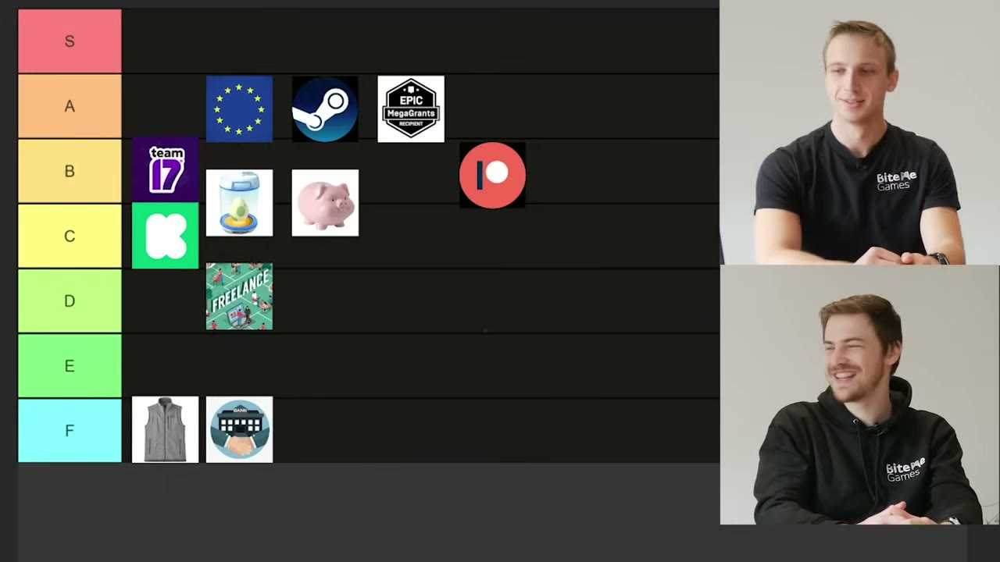

# How BiteMe Games Weighs Indie Game Funding Options

A detailed reading of BiteMe Games’ funding tier list, comparing runway, ownership, workload, timing, and the consequences of failure.

Source: [Ultimate gamedev funding tierlist](https://www.youtube.com/watch?v=qjyPRnzlx8A) · BiteMe Games · Published 2023-11-10
Video: 40:06 · Reading: ~17 minutes · Basis: captions + 12 inspected snapshots

[Web edition](how-biteme-games-weighs-indie-game-funding-options.html)

Topics: Game development · Funding
Generated: November 2026
Processing tokens: ~28,000 (estimated) — Visible-work estimate from a per-video ledger: about 113,516 characters of repository guidance, complete transcript, source-metadata excerpt, outline, authored article/observation code, and audit/browser-check code, divided by four and rounded to the nearest thousand. Each listed text artifact is counted once. Excludes image tokens, repeated context processing, hidden reasoning, uncaptured tool output, and unrelated work. This is a partial workload proxy, not billed usage.

## Overview

BiteMe Games ranks eleven funding routes for a small indie studio, from crowdfunding and publishers to savings, grants, existing-game income, and freelance work. The presenters favor favorable grant terms and income from finished games, while treating debt and venture backing as poor matches for their own goals. Their reasoning is more useful than a universal tier letter: every route exchanges something—time, ownership, autonomy, previous work, or personal financial exposure—for room to keep developing. This reading preserves their examples and qualifications, with funding-program details framed as their 2023 account.

### What the snapshots add

- The final on-screen board resolves tentative spoken rankings and shows that incubators and personal savings are placed between B and C. Most other inspected frames contain the presenters rather than additional documentary evidence.

## Key takeaways

- **The headline amount is only part of the deal** Recoupable services, equity, fulfillment, and ongoing community work can substantially change what a funding source actually contributes.
- **Timing can determine whether good terms help** A grant that arrives after months of administration or reimburses spending later may not solve a short project’s immediate cash needs.
- **Different routes require different assets first** A back catalogue, an audience, professional client skills, and personal savings are valuable prerequisites that cannot simply be assumed.
- **Compare the downside as well as the runway** Selling company equity, recouping a publisher advance, spending savings, and borrowing do not create the same obligations when a game fails.

## Crowdfunding: a campaign needs an audience before it needs a funding page

Source timestamp: [0:00](https://www.youtube.com/watch?v=qjyPRnzlx8A&t=0s)

BiteMe Games approaches funding as the practical problem of paying for life while building a game. The presenters compare routes they have used, investigated, or heard about from other developers. Their tier list is an opinionated discussion aimed mainly at people considering a full-time indie studio, not a financial model showing that one route always wins. They begin with crowdfunding because its appealing promise can hide substantial work.

The basic proposition is familiar: present a game idea or prototype and ask backers to fund it through a campaign. Their central objection is that the platform will not necessarily provide the audience. One presenter recalls a rough estimate that only about 20% of backers arrive organically through Kickstarter and the remaining 80% must be brought by the campaign. He does not substantiate that figure in the video; the argument is that a funding page should not be mistaken for an audience-acquisition plan.

Rewards can create a second business inside the first. Posters, prints, and figurines have production and fulfillment costs, and worldwide shipping adds administration, time, and country-specific complications. They know of developers whose reward pricing failed to cover the goods and associated obligations. Raising money can leave less usable development funding than the headline total suggests.

The campaign itself needs continuing updates, trailers, community engagement, and supporters willing to tell other people about it. It is not something a developer posts once and then ignores. The presenters see this as particularly difficult for someone making a first game without a following.

They still recognize benefits: successful backing can demonstrate interest, create a core audience, and generate publicity. A team whose publisher suddenly withdraws might already possess the community needed for a replacement campaign. They also contrast crowdfunding with taking on a bank loan, while not establishing that failed campaigns carry no obligations. Their spoken C-versus-D debate ends with the Kickstarter icon in C on the final board: possible and sometimes useful, but unattractive as the default starting point for an unknown beginner.

## Publishers: evaluate the services and recoupment, not just the advance

Source timestamp: [4:37](https://www.youtube.com/watch?v=qjyPRnzlx8A&t=277s)

The presenters argue against treating a publishing deal as free money or proof that a game is now destined to succeed. Their example is an advance that helps fund production, followed by revenue used to recoup agreed costs and a continuing publisher share. They use bank-like language to emphasize the cost of capital, but also acknowledge that a publisher may bear the commercial loss if a game fails. Revenue recoupment and personal debt are not automatically the same arrangement; the actual agreement matters.

A good publisher can provide production support, marketing knowledge, contacts, extra people, and access to markets the developer does not understand. The presenters have self-published and say their channel and other income give them unusual flexibility to avoid a publisher. That situation is part of the perspective behind their criticism, not a resource every viewer can assume.

Their negative examples concern both unfavorable terms and mismatched services. They describe approaches with very large publisher shares during recoupment, followed by a smaller but continuing share afterward. They also mention producer turnover, which can weaken the continuity of advice and relationships across a long project. These are examples they report, rather than a standard contract applying to every publisher.

A larger nominal budget may also contain spending the studio would not choose itself. One anecdote concerns a Belgian developer assigned €10,000 for Chinese localization of a text-heavy game despite the team's doubts about its value. Another example is an expensive convention presence that the developer may still have to recoup. More money routed through the project is not automatically more useful runway for the team.

They are especially frustrated by interested publishers asking developers to return later. Their interpretation is that some of these publishers want stronger evidence of market demand—playtests, community response, and validation—rather than merely a more polished idea. Waiting shifts more development risk and expense onto the studio. Their account does not establish the motive behind every delayed decision, but it explains why polite interest is not the same as committed funding.

Despite the criticism, they place publishers in B. The important question for them is whether the actual package of funding, expertise, reach, control, and cost is a useful exchange for this studio. A publisher can be valuable without being a universal rescue plan.

## Incubators: early support is exchanged for a lasting stake in the studio

Source timestamp: [11:00](https://www.youtube.com/watch?v=qjyPRnzlx8A&t=660s)

An incubator, as described here, supplies some combination of workspace, training, administration, contacts, and startup money in exchange for equity. Unlike a deal focused on one game, the stake concerns the company and therefore potentially its later projects as well. The presenters think this can help developers who want to concentrate on making games and need help with the surrounding business.

Their Belgian example is roughly €25,000–€50,000 in startup support for around 10% equity, with the lower amount described as more typical in their experience. They ask whether the immediate benefit justifies the long-term ownership trade. The figures are illustrative historical examples from the conversation, not a current offer or a general valuation rule.

The cash can also disappear faster than a new founder expects. Paying oneself and one additional person, before considering office costs, can turn an apparently large sum into only a short runway. Funding an artist may fill a critical skill gap, but it does not necessarily pay for the whole production. A team can finish the initial support period still needing another source of money.

BiteMe chose to handle much of this internally because its four-person team already had some finance and business capability and was working remotely. They also discuss a full-time participation requirement that would have conflicted with their own part-time start. That is a condition of the kind of program they considered, not a claim that every incubator everywhere requires someone to quit another job.

The discussion settles around B minus, and the final icon sits across the B/C boundary. They see a real early boost from services and networks, but worry about giving away company equity for help the team may eventually outgrow. The fit depends partly on whether those services solve problems the founders cannot already handle.

## Government grants: favorable terms can still come with expensive delays

Source timestamp: [14:38](https://www.youtube.com/watch?v=qjyPRnzlx8A&t=878s)

The presenters are positive about public funding while drawing on a frustrating application experience. They distinguish three programs they investigated: a Flemish audiovisual/game fund, Flanders Investment & Trade support, and Creative Europe. Their descriptions reflect the rules and their understanding in 2023; the video does not supply a current application guide.

They describe the audiovisual fund as supporting amounts from around €25,000 up to a much larger overall ceiling, with repayment arrangements that can place the fund behind other claims on a successful game's income. They contrast that with an approximately €9,000 export-related award that they say did not need repayment if its conditions were met. The useful distinction is between different structures and eligible uses, rather than treating all grants as interchangeable cash.

Their account of Creative Europe emphasizes a different cash-flow problem: reimbursement can arrive after the team has already financed and undertaken the work. They discuss narrative-game eligibility and a possible contribution toward development costs, but also admit uncertainty about some details. A reimbursement opportunity is not necessarily a solution to having no money at the start.

The strongest practical example is their own €25,000 prototype application. One presenter says he spent about two weeks writing the scope, mechanics, budget, schedule, and estimates for activities such as art and interface work. They then waited four months before a short jury discussion and were rejected, in their account because the team did not have an artist.

During that wait, the studio released Forge Industry, supported it after launch, attended conventions, and gained much of its channel audience. The comparison shows how far a small team can move while a funding application remains unresolved. A slow decision can make an otherwise attractive program a poor match for a six-to-twelve-month project, while a longer production may have more room to accommodate it.

Application windows are another constraint. The presenters recall limited annual calls and, in one case, a very short submission period. Those remembered schedules should not be used as current deadlines. Their broader point is that the team must account for the paperwork, eligibility, decision time, payment timing, and conditions as well as the amount advertised.

They assign public grants A when the location, program, and studio schedule align. Their enthusiasm comes from comparatively favorable terms and support for work that may otherwise be difficult to fund. The ranking does not mean approval is likely, that the paperwork is free in terms of labor, or that every country offers comparable support.

## Venture capital: their strongest objection is a mismatch of studio goals

Source timestamp: [20:36](https://www.youtube.com/watch?v=qjyPRnzlx8A&t=1236s)

The presenters describe venture capital as selling a share of the company in a funding round, using an example of 20% for an investment of 200,000 (the currency is not specified in the captions). They compare it with an incubator that can provide more money but may not supply the same package of practical startup services. In their account, investors are usually funding the studio and its longer-term commercial prospects rather than simply paying to complete one small game.

They mention a Belgian studio that also rents motion-capture facilities as an example of the wider business activities an investment-backed company might pursue. The point is that the resulting company can have goals beyond the founders' next creative project. They worry about pressure, loss of freedom, and expectations that do not match the small independent studio they want to run.

They place venture capital in F, but later acknowledge that they have not actually financed their own studio through it. This is therefore one of the less directly experienced judgments in the video. Their later comparison with bank loans also recognizes an important difference: selling equity is not automatically the same as taking on personally secured debt. Their shared low ranking should not erase that distinction.

## Previous-game income: a useful recurring stream with an expensive entry requirement

Source timestamp: [21:52](https://www.youtube.com/watch?v=qjyPRnzlx8A&t=1312s)

Once a game is released, it can continue to sell while its developers work on something else. The presenters call this Steam residuals and see it as one of the strongest sources of supplementary funding. The core product already exists, and a new sale does not require repeating its entire development process.

They nevertheless qualify the idea of passive income. Updates, postlaunch support, further marketing, and improvements to the store page may affect how much money continues to arrive. They describe the revenue as something that may supplement development rather than necessarily cover a whole salary or studio budget. Their reference to a storefront percentage belongs to the discussion's period and is not a complete account of every deduction from a sale.

A back catalogue can combine several modest streams. They recall a talk about a developer whose many small games eventually produced a substantial aggregate income, and illustrate the idea with games contributing a few hundred per month each. The example is not a promise that releasing more games will reliably generate those sums. It explains why they value finished, sellable work over an indefinitely unfinished first project.

The obvious barrier is that the first game had to be funded already. This route is much more available to someone with a released catalogue than to someone starting from zero. They suggest getting an initial release out while another job still pays the bills. After debating S, they choose A because of the substantial prerequisite. The final board confirms that placement.

## Savings: clear runway and creative control, with the downside carried personally

Source timestamp: [24:02](https://www.youtube.com/watch?v=qjyPRnzlx8A&t=1442s)

One presenter says he quit his job after building savings and is still drawing on them while the studio's revenue grows. This offers a clear planning advantage: he knows the available amount and his approximate monthly spending, so he can estimate how long he can continue. There is no new publisher or investor deciding what the game must be.

That freedom is attractive for a project whose value depends on creative control. It can also reduce the immediate pressure to spend time pitching other funders. But the presenters repeatedly return to how hard it is to accumulate the savings in the first place. Their examples favor people with an established previous career and manageable living costs, rather than assuming a new graduate has substantial spare capital.

The downside is illustrated with a hypothetical 50,000 savings budget (currency unspecified) spent over about eighteen months, followed by a failed launch. The person may have gained experience and made a game, but the cash buffer is gone. The presenters therefore stress the importance of a fallback, such as returning to paid work, rather than treating savings as risk-free merely because no lender is involved.

They settle around B minus, and the piggy-bank icon crosses the B/C boundary on the completed board. For someone who can afford the exposure, self-funding can fit better than a publisher. That does not make it equally accessible or sensible for every household. Their comparison concerns the balance between autonomy and personally absorbing the loss.

## Bank loans: the obligation can outlast the game

Source timestamp: [26:19](https://www.youtube.com/watch?v=qjyPRnzlx8A&t=1579s)

The presenters put bank loans in F. Their first concern is access: they doubt an inexperienced developer can easily borrow on the strength of an unproven game. Their larger objection is what happens if the game fails. Losing a savings budget leaves a smaller financial buffer; a loan can leave an outstanding repayment obligation after the project has stopped generating hope or income.

They use the possibility of losing a home as a vivid example of the stakes. Whether personal assets are exposed depends on the borrower, guarantees, security, and agreement; the video does not establish that every business loan creates the same liability. The point of the segment is the presenters' unwillingness to accept that kind of downside for speculative indie development.

Their joke that venture capital cannot simply come for a house also underlines why the funding structures should not be collapsed together. Both categories receive F in this particular ranking, but an equity stake and a debt claim create different obligations. The tier letter alone is not enough to describe the risk.

## Other grants and competitions: valuable additions when the opportunity fits

Source timestamp: [27:27](https://www.youtube.com/watch?v=qjyPRnzlx8A&t=1647s)

The discussion then returns to grants outside government programs, with Epic MegaGrants as its principal example. The presenters say they know developers whose careers were helped by such support and contrast it with surrendering company equity to an incubator. Their enthusiasm is for a useful contribution that can leave the team in control of its business.

They mention a €25,000-style example, but do not provide a current schedule of award sizes, program rules, or engine eligibility. The conversation also includes a pointed appeal for Unity to offer comparable support during the controversy surrounding that company in 2023. Those remarks explain the context and sentiment of the recording, rather than describing today's engine-funding landscape.

Competitions and some game jams can likewise supply prize money and visibility. The presenters think of these as an extension to runway and a signal that someone outside the team sees merit in the work. A favorable jury response can be encouraging without establishing that a full market will buy the game.

They put this category in A when funding can actually be obtained. The qualification matters: an attractive award is a possible supplement, not a dependable salary before a decision exists. Their argument is to recognize the opportunity and its benefits, rather than build a budget that assumes a competition has already been won.

## Community funding: recurring support also creates recurring work

Source timestamp: [29:52](https://www.youtube.com/watch?v=qjyPRnzlx8A&t=1792s)

Community-funded development differs from a single deadline-driven campaign. Supporters contribute repeatedly through platforms such as Patreon or Ko-fi, perhaps in exchange for progress updates, early builds, closer contact, or other benefits. The presenters compare this with a continuing crowdfunding effort, but emphasize that the operating rhythm is different.

The prerequisite remains an audience. A developer must offer a reason for people to keep following and contributing, and that can require videos, tutorials, updates, community management, or personal visibility. For a solo creator, producing that material can compete directly with making the game. An attractive recurring revenue line on a spreadsheet represents continuing relationship work, not just another payment button.

The community can contribute more than money. People who believe in a project may join playtests, give useful feedback, and enjoy taking part in its creation. The presenters value the difference between supporters voluntarily contributing through enthusiasm and testing arranged solely as a paid service, while not claiming that either replaces every form of quality assurance.

They have only recently launched their own Patreon and openly promote it during the discussion. They describe considering it once their channel had developed a substantial audience, not beginning with the assumption that an unknown first game could immediately be supported this way. Their own interest in recurring income is part of the context for the ranking.

In comparing it with Kickstarter, they argue that recurring updates can be simpler and less polished: a screen recording describing a new feature may be enough to give an interested supporter something useful. A timed campaign may require a concentrated period of higher-production-value promotion and can miss its goal entirely. Recurring support can instead grow gradually, fluctuate, and still provide some benefit at a small scale. The presenters' aside about keeping failed Kickstarter proceeds is uncertain and should not be read as platform policy.

They choose B, above one-time crowdfunding in C. The difference is not that ongoing support requires no work, but that its lower-intensity cadence and longer growth period can fit an existing community. They explicitly warn against assuming the route is suitable for everyone or announcing community funding before a community has actually developed.

## Freelancing: paid development time competes with progress on the studio’s own game

Source timestamp: [34:16](https://www.youtube.com/watch?v=qjyPRnzlx8A&t=2056s)

Work for hire lets a developer fund an original project by doing paid work for another studio. The presenters describe a familiar weekly split: two or three days on client work and the remaining days on the team's own game. It can keep someone working in the industry and bring in money without requiring a successful original release first.

Their concern is that the output lost is greater than the simple percentage of hours redirected. Switching between games drains attention, creates different priorities, and can leave little energy for the independent project. One cannot assume that retaining 60% of the week automatically retains 60% of creative progress.

They prefer an example in which a Belgian developer works for clients for roughly six months and then uses that income to fund a sustained period on his own game. The alternating blocks still mean fewer calendar months on the original work, but reduce the repeated switching and give each activity a clearer stretch of momentum. This is an approach they admire, not proof that six-month contracts or matching income are available to everyone.

Finding the clients is itself work. The presenters discuss competition from experienced people affected by layoffs in the period of the recording and the difficulty of being hired without a portfolio, relevant experience, or contacts. A person trying to enter game development from an unrelated career may not yet have the professional credibility needed to sell part-time services to studios.

They assign D. They acknowledge that the route can work for particular people, but dislike how much it delays the independent game and how much effort can go into securing paid tasks. For their intended audience, they often prefer retaining another career and accumulating a buffer before the switch. The ranking reflects their priority of progressing their own games, not a claim that freelance work has no professional value.

## Read the final ranking alongside the studio and household behind it

Source timestamp: [37:19](https://www.youtube.com/watch?v=qjyPRnzlx8A&t=2239s)

The final board provides a useful check on the conversational decisions. Public grants, Steam residuals, and Epic-style other grants occupy A. Publishers and Patreon-style recurring support occupy B. Incubators and savings sit across the B/C boundary, matching the spoken B-minus descriptions. Kickstarter is C, freelance work is D, and venture capital and bank loans are F. Nothing ends in S or E.

The presenters close by acknowledging an omitted route: keeping a full-time career and developing a game on the side. They leave it largely outside the list because they intended to discuss moving toward a full-time indie studio. That omission is important. The ranking does not compare every possible way to make a game, and it should not be interpreted as a case against hobby or part-time development.

Their judgments also reflect the kind of company they want. They favor autonomy, have some business knowledge already, have released a game, and have a channel that can support community-based income. A founder without those resources, or one pursuing a larger investment-backed studio, is evaluating a different situation. They admit that their venture-capital assessment is less directly experienced and invite other perspectives.

Household circumstances matter too: rent, dependents, existing employment, available savings, and tolerance for losing income can change how the same offer feels. The useful product of the tier list is therefore the set of tradeoffs behind its letters. Where does cash arrive, what work or ownership is exchanged, how long must the team wait, and who carries the downside if the game does not earn enough? The presenters' answer for BiteMe is not automatically the answer for another studio.

[37:28](https://www.youtube.com/watch?v=qjyPRnzlx8A&t=2248s) — The final board preserves the actual placements, including incubators and savings straddling B/C. The letters reflect the presenters’ preferences and circumstances, not a universal order of funding quality.

## Source and limitations

- Based on the complete English automatic captions and 12 inspected snapshots at category discussions and the final overview. Some snapshots show an incomplete board or no board; the final 37:28 frame is the source for the completed ranking. No continuous visual review was performed.
- This is a synthesis of the presenters' historical opinions and reported experiences, not independent financial or legal guidance. Specific grant amounts, eligibility, application schedules, repayment terms, platform rules, and labor-market claims were not verified against current programs or contracts.
- Caption errors affect some names, money discussions, and tentative tier letters. Unclear program details are not silently converted into authoritative instructions. The article distinguishes examples and anecdotes from rules applying to every funding arrangement.
- The presenters disclose limited direct experience with venture-capital financing, promote their own recently launched Patreon, and have a channel and business background that affect their preferred options. The list is aimed chiefly at full-time indie development rather than every kind of game-making arrangement.

[Timestamped source captions](../../sources/ultimate-gamedev-funding-tierlist/source.json)
[Snapshot observations](../../sources/ultimate-gamedev-funding-tierlist/visuals.json)
