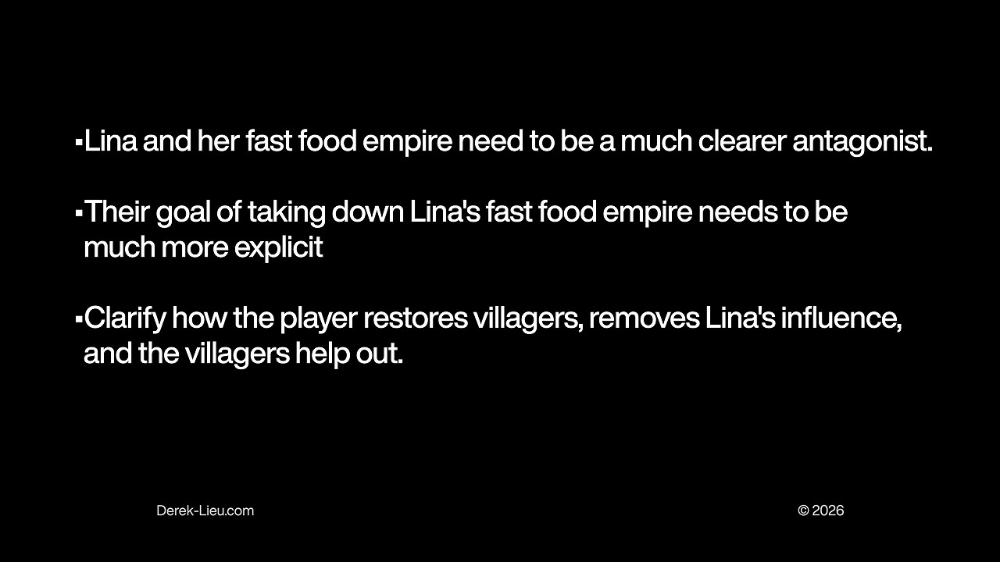
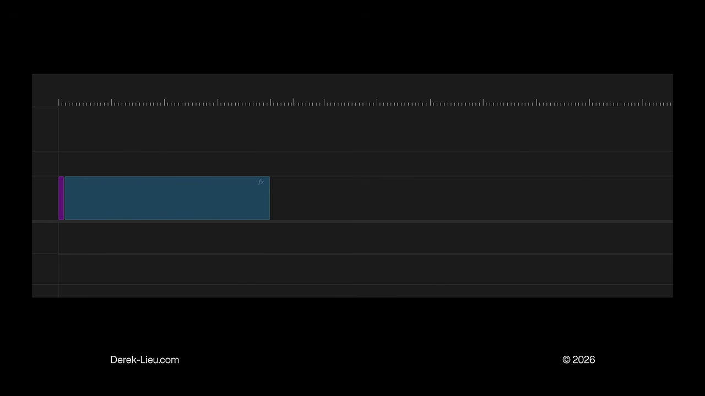

# Structuring a Game Trailer Like a Clear Verbal Pitch

Derek Lieu explains how genre, fantasy, hooks, complications, and goals can give a trailer a clear structure before editing polish is added.

Source: [The Best Game Trailer Template | Video Game Trailer Academy](https://www.youtube.com/watch?v=2F5WBfqf0Sc) · Derek Lieu · Published 2026-07-14
Video: 31:08 · Reading: ~16 minutes · Basis: captions + 22 inspected snapshots

[Web edition](structuring-a-game-trailer-like-a-clear-verbal-pitch.html)

Topics: Game marketing · Trailers
Generated: November 2026
Processing tokens: ~26,000 (estimated) — Rough visible-text workload estimate: 102,734 characters divided by four and rounded to the nearest thousand. Counted repository, skill, and format guidance; complete transcript; metadata excerpt; outline; and final authoring, observation, contact-sheet, and verification code once per artifact. Two reused helper scripts read during this run are included once. Excludes image tokens, hidden reasoning, unmeasured context replay, uncaptured tool text, intermediate edits, unrelated work, and later revisions. This is a partial workload proxy, not complete billed usage.

## Overview

What belongs in a game trailer, and in what order? Derek Lieu’s answer is to start with the logic of a good verbal pitch. The viewer needs enough context to understand the game, a reason to find it distinctive, and a progression of ideas that makes later footage meaningful. Choosing striking shots first and adding trailer-like polish afterward can conceal the absence of that structure.

The lesson moves through three common mistakes, a pitch template credited to Jonas Tyroller, the relationship between familiar genre anchors and distinctive hooks, and examples from Papers, Please, Unpacking, and Super Mario Odyssey. Its final case study shows how clarifying the goals and relationships in Dosa Divas guided revisions to an announcement trailer. The template is a starting skeleton for an edit, with room for exceptions when audience familiarity or an unusually novel premise supplies context.

### What the snapshots add

- Twenty-two targeted snapshots were inspected, including follow-ups for obscured or incomplete examples. They verify the feature-list slide, selected game footage, the explicit Dosa Divas revision requests, and the short genre block in the timeline diagram. The complete formula and several described moving sequences were not visible in the selected stills; their explanations below come from the captions.

## Key takeaways

- **Make variety meaningful before showing its extent** Biomes, costumes, and late-game spectacle are easier to value after the audience understands what the player does and why it is interesting.
- **Give one to three pillars most of the attention** Equal time for every feature makes the distinctive ones harder to remember and can misrepresent the experience’s actual emphasis.
- **Use genre recognition as a quick starting point** Familiar perspective and player-controlled action can establish anchors rapidly. Move on to the hook rather than spending the opening proving every genre convention.
- **Connect actions to complications and goals** A clear objective makes mechanics feel purposeful, especially when the game lacks an immediately compelling, self-explanatory hook.

## Start with the order in which a stranger needs information

Source timestamp: [0:00](https://www.youtube.com/watch?v=2F5WBfqf0Sc&t=0s)

Lieu frames the recurring trailer-making problem as two linked decisions: what to show and what order to show it in. After making hundreds of trailers, he sees creators overcomplicate those decisions by thinking first about what a trailer is supposed to look like.

His proposed foundation is a verbal pitch. If the game cannot be explained coherently in words, a collection of attractive images is unlikely to fix the missing logic. The finished video can do far more than spoken explanation through sound, performance, and editing, but it still benefits from presenting understandable ideas in a useful sequence.

## Mistake one: showing variety before establishing value

Source timestamp: [0:42](https://www.youtube.com/watch?v=2F5WBfqf0Sc&t=42s)

An opening montage of environments tells the audience that the game has many biomes, but not why visiting them will be interesting. Lieu makes the same criticism of early montages of costumes and other nonessential customization. Viewers have not yet been given a reason to care about extending the experience.

His analogy is an ice-cream shop a thirty-minute drive away. Listing familiar flavors and toppings does not explain why somebody should make the trip; those are things they already expect an ice-cream shop to have. A new game likewise cannot be sold only by enumerating its similarities to existing choices.

He is not banning these montages. He suggests reserving them until at least around the middle of the trailer, after the audience has a taste of the underlying activity. Variety then expands something already appealing. Without that base, the amount of content has little persuasive force.

## Mistake two: showing only the complicated later game

Source timestamp: [2:04](https://www.youtube.com/watch?v=2F5WBfqf0Sc&t=124s)

Creators often choose mid- or late-game shots to skip apparently dull material and show the most exciting state. The risk is that viewers receive spectacle before they understand its components. A dense image may be impressive to the developer while remaining undecipherable to a newcomer.

Lieu contrasts a huge Factorio factory with a simpler introduction involving only a small group of machines and a conveyor. The inspected later-game frame is full of belts, inserters, and repeated machinery. His argument is about sequencing: establish the basic relationship first, then the audience can appreciate what the larger system adds.

He acknowledges using advanced cold opens himself in Skin Deep, Spelunky 2, and Noita. The important qualification is what follows. He returns to the fundamentals: boarding a ship and rescuing cat crew members, beginning a platforming run, or descending into a cave whose materials physically interact. An arresting opening can work if the trailer then supplies the foundation needed to interpret it.

## Mistake three: treating every feature as equally important

Source timestamp: [3:47](https://www.youtube.com/watch?v=2F5WBfqf0Sc&t=227s)

After years of development, a team understandably wants to show everything. But giving equal emphasis to every system reduces the significance of each one. Lieu criticizes the abundance of feature callouts in a Hollow Knight trailer, while acknowledging the game’s quality helped it succeed. His point is that another project should not assume it can ignore clarity because a famous game did.

The inspected slide makes the overload visible by spreading labels such as charms, upgrades, enemies, bosses, travel, barter, and relaxation across the image. None is necessarily a bad feature. The problem is that an unweighted inventory does little to tell the viewer which elements define the experience.

His Breath of the Wild example is hypothetical: giving climbing, fishing, cooking, combat, puzzles, and house decoration the same weight would obscure how central exploration and climbing are. In his account, the actual trailers gave those activities both screen time and cinematographic emphasis. A new indie game without an established reputation has particular reason to make that emphasis legible.

Lieu recommends one to three pillars. Describing a friend through a few memorable traits is his analogy: the introduction should give somebody a useful identity, not an exhaustive biography. Firewatch can be introduced through a fire lookout, radio conversations, and a mystery; Stray Gods through modern Greek gods, murder mystery, and an interactive musical; Venba through immigrants, cooking, and family. The chosen emphasis should also fit the game. His deliberately extreme example is a game with very little story whose trailer spends half its time on story.

[4:30](https://www.youtube.com/watch?v=2F5WBfqf0Sc&t=270s) — The Hollow Knight feature list illustrates the problem of giving many ideas similar weight. A focused introduction needs to make its defining pillars stand out.

## A trailer does not need to imitate trailer conventions

Source timestamp: [6:45](https://www.youtube.com/watch?v=2F5WBfqf0Sc&t=405s)

Logos, title cards, voiceover, and slow environmental openings are not inherently useful because other trailers contain them. Lieu argues against inserting them merely to make the edit feel legitimate. Each device needs to contribute to the introduction being made.

He reserves leisurely openings for situations where the audience is effectively captive or has already committed to watching. An unknown game encountered in an ordinary feed cannot safely assume the attention available to a major showcase reveal.

Tiny Glade supplies his alternative: a short sequence of five shots, relaxed music, clear progression, and eye trace that keeps the action easy to follow. He praises it for showing what that particular game is and is not. The inspected still shows the stone-building scene and cursor, while the account of the full edit follows his explanation. A trailer can be modest in form and still do its job extremely well.

## Test the pitch before decorating the edit

Source timestamp: [8:12](https://www.youtube.com/watch?v=2F5WBfqf0Sc&t=492s)

Lieu first gives a deliberately bad Spelunky 2 pitch: jetpacks, cats, bosses, randomized levels, digging, enemies, gems, money, and purchases. Someone unfamiliar with the game still cannot tell whether it is first person, third person, two-dimensional, or something else. The details lack an organizing idea.

His improved pitch starts with a side-scrolling platformer about exploring a mine for treasure. It then explains randomized layouts, enemies and traps whose behavior must be learned, and limited starting resources—four bombs, four ropes, and four hearts—before mentioning more biomes and secrets. The difference is that each new detail now has a place in the picture the listener is building.

The food-shop analogy returns: establish what kind of food is being served, then explain what makes this particular place worth trying. A text pitch is a useful test because impressive visuals cannot distract from an illogical sequence. Once the explanation works, well-chosen footage and sound enhance it; simply placing game images on a timeline does not guarantee understanding.

## The basic template: genre, fantasy, actions, and distinction

Source timestamp: [10:18](https://www.youtube.com/watch?v=2F5WBfqf0Sc&t=618s)

Lieu credits Jonas Tyroller’s video about what sells on Steam for the starting formula: “\[NAME\] is a \[GENRE\] game about \[FANTASY\]. You \[VERBS + USP\].” USP means the unique selling point. The brackets are prompts for clarifying the game, not a requirement to place this exact sentence in a trailer.

Genre supplies the broad category. Fantasy means the role or experience the player inhabits: a globetrotting adventurer in Uncharted, climbing a mountain with friends in PEAK, or operating an enormous defense cannon in PVKK. Verbs describe what the player actually does. The distinctive element explains why those actions promise something beyond a familiar substitute.

Thronefall is his compact example: a minimalist strategy game about building and defending a kingdom, with construction during the day and fighting alongside units at night. That introduction supplies a category, an objective fantasy, and a concrete rhythm of activity without listing every available building or upgrade.

## Papers, Please teaches a novel loop before adding complications

Source timestamp: [11:21](https://www.youtube.com/watch?v=2F5WBfqf0Sc&t=681s)

Some games have a premise unusual enough that showing how it works is already the main hook. Lieu groups Papers, Please, Unpacking, and Tiny Glade in this category. Their trailers need not begin by explaining every story detail or long-term objective, because the immediate interaction can create interest on its own. His first-to-market framing is a marketing interpretation of these examples, not an independently verified claim of absolute invention.

He describes the Papers, Please trailer as spending roughly forty seconds on its fundamental loop: call somebody into the booth, receive papers, inspect them, stamp a decision, and send the person away. The selected still shows a visa and the stamping interface. Only after that foundation does the trailer add roughly fifty seconds of changing rules, additional paperwork, contraband searches, and threatening incidents.

The last roughly fifteen seconds emphasize the variety of people encountered. Those times describe the embedded trailer, not the running time of Lieu’s lesson. The progression is the point: establish an understandable job, complicate the job, then show its breadth. It does not explain the whole game, but it gives a stranger enough to become interested.

## Unpacking builds from placement into a larger experience

Source timestamp: [13:28](https://www.youtube.com/watch?v=2F5WBfqf0Sc&t=808s)

Lieu reverse-engineers Unpacking’s trailer as another verbal pitch. Begin with a pixel-art room and boxes; open a box, reveal an object, and place it. The uncertainty of what comes out next is part of the appeal. The inspected follow-up makes the interaction concrete: an isometric bedroom, packed and open boxes, and an object held by the cursor near the desk.

The explanation then expands through different rooms and moving an object to its appropriate room, such as taking a pot from a living-room box to the kitchen. Decorating choices and small interactions become meaningful once the basic action is understood. The rooms belong to one person’s life, and objects recurring across moves give continuity.

He also identifies stickers, sharing images with backgrounds, lightly interactive objects, the satisfying disappearance of empty boxes, and multiple levels. These details arrive as extensions of a comprehensible activity. His audit is not an instruction to copy Unpacking’s exact feature order; it demonstrates how one idea can prepare the viewer for the next.

## Establish genre anchors quickly, then move beyond them

Source timestamp: [14:36](https://www.youtube.com/watch?v=2F5WBfqf0Sc&t=876s)

For a game that develops an established genre rather than presenting a wholly unfamiliar premise, Lieu recommends signaling the genre as soon as possible. A familiar camera angle plus a moment of player-controlled gameplay can be enough for an experienced viewer to recognize the broad category.

He credits Chris Zukowski with the term anchors: the conventions and mechanics that reassure genre fans that the core experience is present. Farming in a life sim, coin collection in a platformer, a large map in a Metroidvania, and branching choices or upgrades in a roguelike are his examples. Recognition gives viewers a starting point from which to notice a difference.

His restaurant analogy separates reassurance from persuasion. Familiar dishes on a Chinese restaurant’s menu can make it recognizable, but reciting the entire list does not explain why somebody should try it instead of their usual place. Once the game’s broad identity is clear, the trailer should move toward its distinctive proposition rather than spend the opening confirming every expected convention.

## Hooks describe different reasons someone might want the game

Source timestamp: [17:09](https://www.youtube.com/watch?v=2F5WBfqf0Sc&t=1029s)

A hook creates interest by making a familiar experience meaningfully different, or by offering an appealing unfamiliar one. Lieu uses Dead Space’s dismemberment and Elden Ring’s open-world variation on the Souls experience as quick examples of a recognizable base changed by an important idea.

He cautions that many games have only small differences rather than a strong hook. A different upgrade system, customizable powers, or art treatment does not automatically transform the player’s anticipated experience. The point is not to invent a slogan declaring uniqueness, but to identify what the viewer could actually desire.

Drawing again on Tyroller, Lieu presents several kinds of appeal. The categories overlap and need not all appear in one trailer. They help the creator find the right reason to care instead of assuming every hook must be a novel combat mechanic.

- A novel offering: interest in something that feels new. His examples include Stray, Ghost of Tsushima, and Papers, Please, framed as distinctive arrivals in their markets.
- A world or premise: wanting to explore or inhabit the space. He cites Dredge’s cosmic-horror fishing, Journey’s atmosphere, and Half-Life 2’s oppressive setting.
- Characters: wanting to become someone or spend time with them. His examples include Dispatch, Venba, and Little Kitty, Big City.
- Story: curiosity about what happens and why. He points to Firewatch, Death Stranding, and Clair Obscur: Expedition 33 as different ways to create that curiosity.
- Challenge: wanting to prove oneself against a compelling problem, as in Souls games, Cairn, or Baby Steps.
- Interaction: wanting to try a mechanic or repeat a satisfying activity. He cites SUPERHOT’s time-and-movement relationship, restoration in Reshine, Viewfinder’s interactions, and factory building.

## Super Mario Odyssey introduces a hook and then explores it

Source timestamp: [20:31](https://www.youtube.com/watch?v=2F5WBfqf0Sc&t=1231s)

Lieu analyzes the Odyssey trailer’s opening T-Rex mystery as a privilege of context. It played during an E3 presentation to an audience already watching, and Nintendo’s reputation supplies expectations an unknown indie project cannot assume. When the dinosaur’s cap and Mario appear, the first message is that this is a Mario game.

The next question is which kind. Movement and camera perspective establish a core 3D Mario game. Some shots resemble the environment montage criticized earlier, but the brand has already filled the viewer’s mind with a large amount of relevant prior knowledge. The selected text slide explicitly identifies the new core 3D Mario message; the account of the sequence follows Lieu’s narration.

Cappy then provides the distinction. Initial examples extend recognizable attacks, jumping, and traversal, but the stronger change is possessing other creatures and using their abilities. Lieu says the frog sequence takes time to make that concept clear before a rapid series of further examples. Once the rule is understood, a Goomba, Bullet Bill, robot, fish, or other target becomes another variation on the same hook rather than a new unrelated feature.

Bosses, costumes, and other footage arrive later. The trailer returns to more possession possibilities and eventually the T-Rex from the opening. It contains a great deal of variety while retaining a focused verbal proposition: a new 3D Mario game whose cap lets Mario use the abilities of other beings. Familiarity explains the exception; it is not a reason for a new studio to copy the opening without context.

## A goal gives mechanics something to accomplish

Source timestamp: [23:39](https://www.youtube.com/watch?v=2F5WBfqf0Sc&t=1419s)

When the hook is less immediately compelling, Lieu finds a clear goal especially useful. Showing what the player can do is not the same as explaining what the player is trying to achieve. The objective need not be profound; saving a princess or increasing a number can both supply direction.

His hammer analogy makes the distinction concrete. The same tool means something different when the task is building a cozy home, performing in a rhythm game, or defending oneself in a fight. Explaining the problem changes how the available actions are perceived. Without that connection, a set of mechanics can feel like a solution waiting for a reason to exist.

## Dosa Divas: diagnose the missing relationship between story and play

Source timestamp: [24:37](https://www.youtube.com/watch?v=2F5WBfqf0Sc&t=1477s)

Lieu presents an early Dosa Divas announcement draft on which he consulted. The inspected draft frames include a food mech over a colorful landscape and a large screen displaying a purple-haired character. Those images establish ingredients of the presentation, but the stills alone do not explain the goal or relationships. His critique concerns the draft as a whole.

He identifies three missing connections: what the protagonists want, how they relate to the antagonist, and how the mechanics advance their purpose. To resolve those questions he asked creative director Chandana Ekanayake to explain the loop and its relationship to the story. The answer provided the organizing material the edit needed.

Amani and Samara are sisters who have fallen out with their sister Lina. Lina built a fast-food empire whose processed meals have displaced nourishing regional South Asian cooking. Amani and Samara travel in a food mech, cook for weakened villagers, reconnect communities with their food and culture, and restore their strength. The villagers can then help the sisters progress toward defeating Lina’s empire and possibly reconciling with her.

The inspected revision slide states the proposed changes explicitly: make Lina and the empire a clearer antagonist, make taking down the empire a more explicit objective, and clarify the chain from restoring villagers to removing Lina’s influence and receiving help. The issue is not simply needing more story footage. The trailer needs the relationship between cooking, community, conflict, and progress to become understandable.

[27:15](https://www.youtube.com/watch?v=2F5WBfqf0Sc&t=1635s) — The revision requests connect the antagonist, the sisters’ objective, and the gameplay loop. The proposed improvement is a clearer causal chain, rather than additional disconnected features.

## Dosa Divas: use the clarified premise to guide the revision

Source timestamp: [27:20](https://www.youtube.com/watch?v=2F5WBfqf0Sc&t=1640s)

Lieu then plays the final announcement trailer, beginning with LinaMeals branding and a jingle in the captions. The selected final-version stills bring the protagonists and mech into the same composition as the large corporate screen, show a character presenting a glowing dish, and show an action encounter. These verify particular visible elements, not every edit or line in the completed trailer.

He regards the revised version as a substantial improvement and acknowledges his own involvement as consultant. The useful lesson is the process: clarify what the game is trying to say, then let that understanding guide emphasis and sequence. These snapshots and his qualitative judgment do not establish a measured change in sales or audience comprehension.

The embedded drafts contain long stretches without transcribed dialogue. This reading therefore preserves the diagnosis and proposed solution supported by his explanation and slide, without reconstructing an unseen or untranscribed complete script.

## Expand the pitch with complications, responses, and a goal

Source timestamp: [28:40](https://www.youtube.com/watch?v=2F5WBfqf0Sc&t=1720s)

The basic pitch introduces the game, but a trailer usually needs development beyond its first loop. Lieu adds another sentence: “\[COMPLICATIONS\] force you to \[VERBS\] in order to \[GOAL\].” The additions explain what changes, how the player responds, and why the response matters.

His Dosa Divas version starts with a turn-based RPG about two sisters piloting a food mech. Cooking, fighting corporate forces, building relationships with communities, and reconciling with loved ones establish the activity. New enemies and strained relationships create pressure to learn recipes and acquire tools, directed toward taking down the sister’s fast-food empire.

This is a first-draft framework, not a promise that a finished trailer should mechanically illustrate each bracket in order. Footage can change the edit. The priority is preserving a comprehensible progression; match cuts, motion graphics, sound effects, and cuts to black can polish that foundation afterward.

## Keep genre recognition brief and spend time developing the hook

Source timestamp: [29:56](https://www.youtube.com/watch?v=2F5WBfqf0Sc&t=1796s)

The closing timeline demonstration emphasizes how little time establishing genre may require. At the inspected moment, a very narrow purple segment precedes a much longer blue block. Lieu’s narration identifies the short opening as player-controlled gameplay that establishes the category, followed by the hook and what the player does. The graphic does not supply a universal number of seconds or a numerical percentage.

The next part explores variations, complications, and possibilities within the hook. Once viewers understand the premise, the ending can be looser because they can interpret new shots in relation to it. This is where a little content variety, costumes, or other nonessential extras may fit, followed by the game title and a call to action.

His final caution is to avoid filling the opening with anchors. If the game does not look as though it contains expected genre staples, add reassurance where useful; otherwise focus attention on what distinguishes it. The template works by giving the audience the necessary foothold quickly and then spending its attention on reasons to want this particular game.

[30:10](https://www.youtube.com/watch?v=2F5WBfqf0Sc&t=1810s) — The tiny opening block contrasts with the longer hook section. This illustrates relative emphasis; the diagram does not prescribe fixed timings or percentages.

## Source and limitations

- Based on the complete manual English-caption transcript of the 31:08 lesson. Some caption wording and game-name transcription are imperfect; unclear nonessential wording is not reconstructed.
- Twenty-two targeted snapshots were inspected, including seven follow-ups to resolve dark frames, presenter-only moments, and an incomplete timeline graphic. Images verify the specific visible details described, not continuous animation, eye trace across every cut, or the entirety of the embedded trailers.
- The complete pitch formula is supported by the captions; the selected formula snapshots show either a partial line or the presenter. The Dosa Divas embeds contain substantial gaps in transcribed dialogue, so a complete before-and-after script is not claimed.
- Recommended structures, interpretations of example trailers, and first-to-market claims are Lieu’s analysis. No independent performance experiment or current market verification was conducted.

[Timestamped source captions](../../sources/the-best-game-trailer-template-video-game-trailer-academy/source.json)
[Snapshot observations](../../sources/the-best-game-trailer-template-video-game-trailer-academy/visuals.json)
