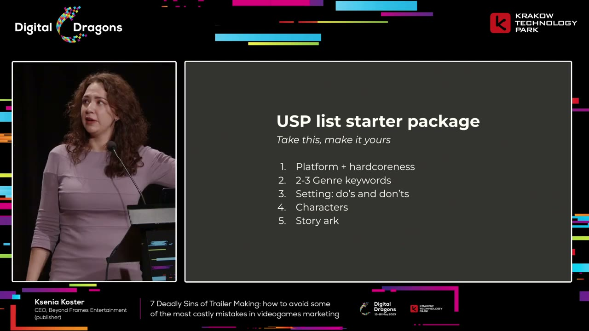
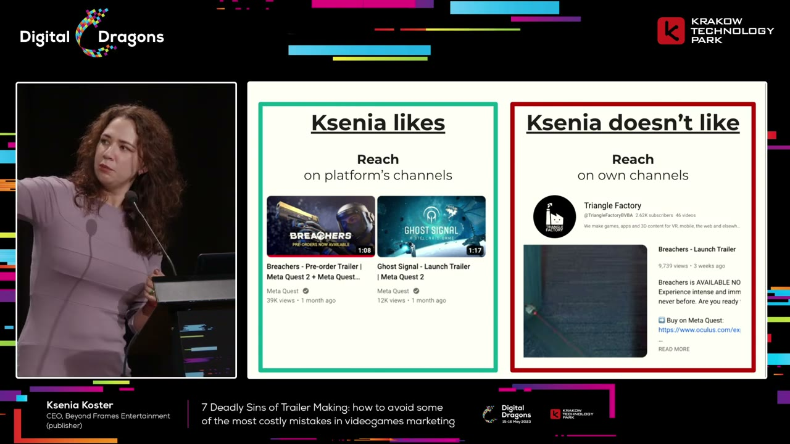
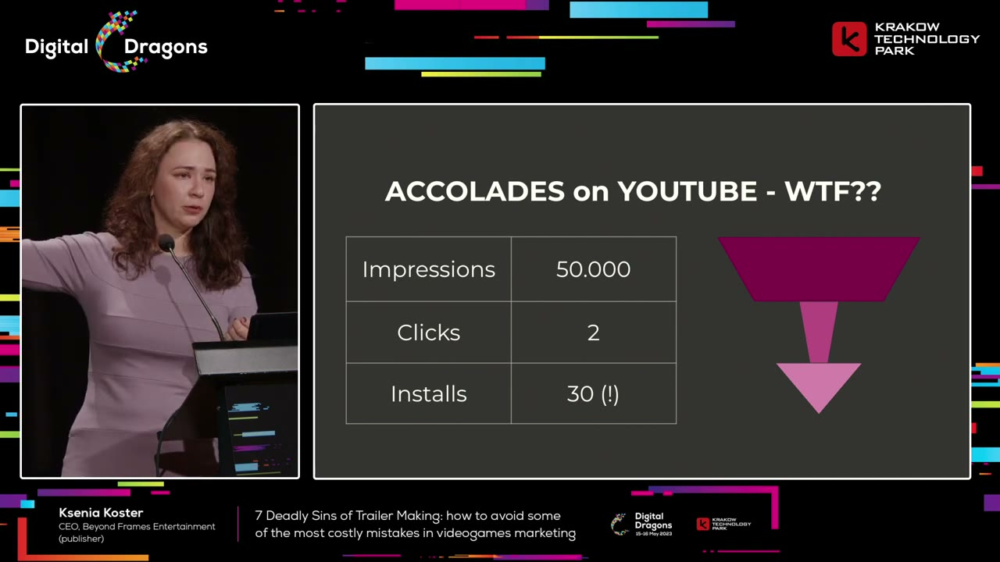
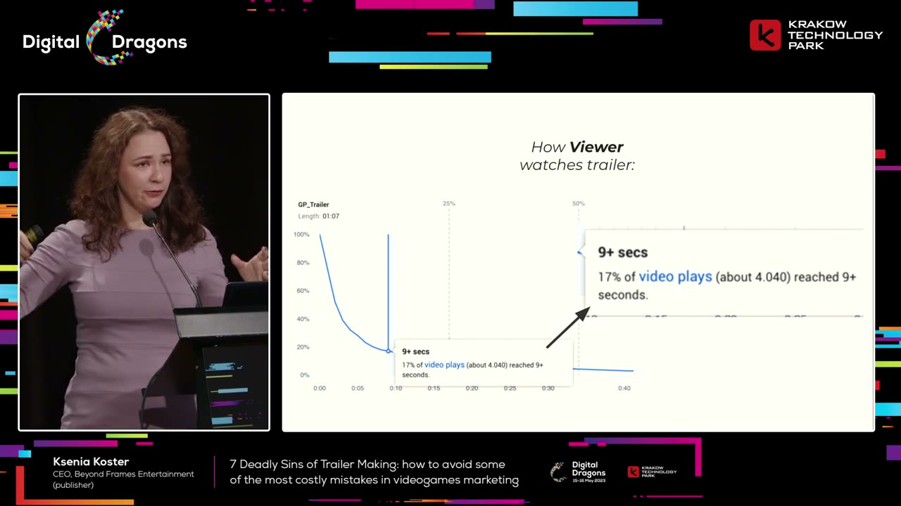
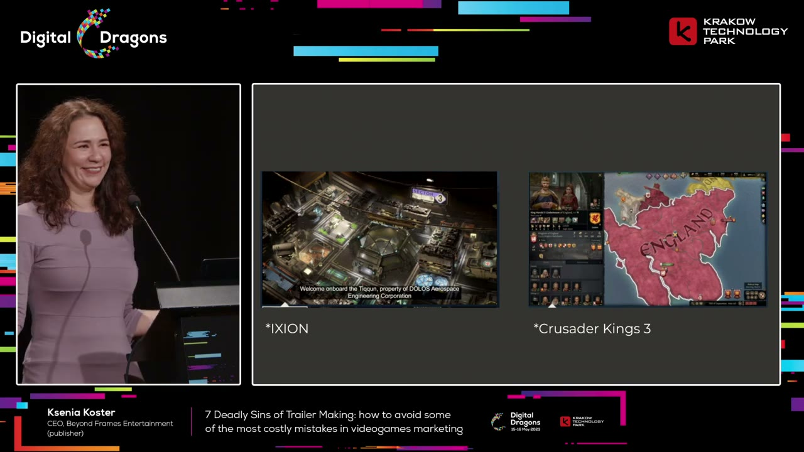
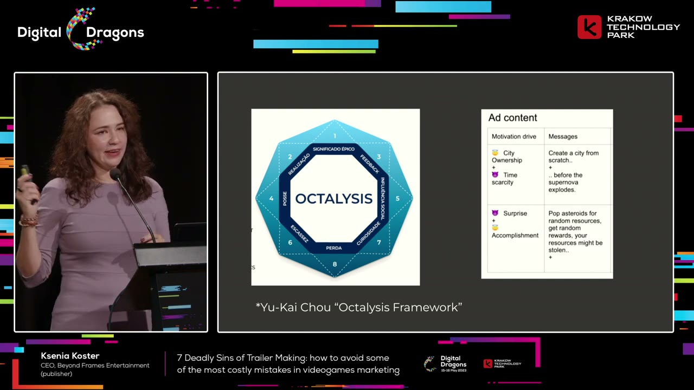

# The seven costly mistakes in game trailers — with slide analysis

A reading edition of Ksenia Koster’s talk, enriched with selected slides, concrete chart values, and a closer look at what the visual examples actually show.

Source: [Deadly Sins of Trailer Making: how to avoid some of the most costly mistakes in videogames marketing](https://www.youtube.com/watch?v=eA4VxgsWDoc) · Digital Dragons · Published 2023-08-22
Video: 40:24 · Reading: ~19 minutes · Basis: captions + 20 inspected snapshots

[Web edition](the-seven-costly-mistakes-in-game-trailers-with-slide-analysis.html)

Topics: Game marketing · Trailers
Generated: November 2026
Processing tokens: Not recorded — Exact per-video model token usage was not recorded during original processing.

## Overview

A trailer is a tool for helping a prospective player decide whether a game offers an experience they want. It has to work in the place where it appears, for the audience that actually needs convincing. A beautiful edit, a long feature list, and enthusiastic internal approval do not establish that it does its job.

In this Digital Dragons talk, performance marketer Ksenia Koster works through seven recurring failures: vanity, poorly chosen metrics, ignoring viewing context, wasting the opening seconds, confusing the trailer's purpose, mismanaging creative risk, and giving up after a failure. Her central concern is the opportunity a weak trailer loses: attention, excitement, trust, and ultimately a decision to wishlist or buy.

### What the snapshots add

- The USP slide supplies five grouped briefing categories. The spoken recommendation of at most seven features is a separate limit.
- The reach screenshots compare a Breachers pre-order trailer with an owned-channel launch trailer, so they do not prove that the exact same cut performed better on one channel.
- The anomalous funnel has concrete values: 50,000 impressions, two clicks, and thirty installs. The retention example is a 67-second video.
- The player-fantasy comparison visibly contrasts unfamiliar worldbuilding with a ruler interface and an England map. The motivation slide adds specific supernova and asteroid-resource examples.

## Key takeaways

- **Decide what matters before editing.** Agree on a focused set of selling points and the wording of on-screen text. The trailer should communicate the experience, not document everything the team built.
- **Measure the audience you are trying to persuade.** Separate paid from organic traffic, put reach in a comparable distribution context, and interpret sentiment within the intended audience.
- **Make the opening earn its place.** Many viewers will never see the payoff at the end. Spend disproportionate effort on the first ten seconds and test them with and without sound.
- **Show a recognizable player fantasy.** Give viewers a reason to care about what they can do or become before asking them to absorb unfamiliar lore. Excitement should help them make a decision.
- **Protect creative work with alternatives.** Trust trailer specialists, avoid giving every stakeholder a veto, and plan a safer alternate edit with the people who bear the actual publishing risks.

## Why make a trailer if so many of them disappoint?

Source timestamp: [0:00](https://www.youtube.com/watch?v=eA4VxgsWDoc&t=0s)

Koster introduces herself as a freelance marketer whose strongest specialty is performance marketing for games. Her work involves taking advertising budgets, putting them into channels such as Facebook, Google, and TikTok, and trying to turn that spending into wishlists or sales. That perspective makes her impatient with trailers that look expensive but communicate little.

Her dislike has several sources. As a viewer, she often finds trailers slow relative to the amount of useful information they contain. As a player, recommendations from friends can matter much more than a trailer. As a professional, she sees teams spend substantial time negotiating a trailer until the result satisfies nobody particularly well. The edit becomes an accommodation of everyone's opinions instead of a strong piece of communication.

Nevertheless, she gives two reasons that trailers deserve serious effort. First, the distribution environment demands them. On storefronts, the trailer is a prominent part of the first impression. She refers to a Steam attention heat map discussed at the conference in which roughly half of viewing time went to the trailer. This is a measurement she cites in the talk, not a universal conversion rule. The inspected storefront slide shows the prominence of video on Steam and a mobile listing, but it is not itself the attention heat map; the roughly-half figure remains a claim from her narration.

Second, a successful trailer creates opportunity. It can win attention, improve how people feel about a game, give enthusiastic players something useful to share, prompt a purchase, and strengthen a studio's reputation. A good trailer lets an advocate communicate excitement to a friend much more easily than a description alone.

A poor trailer can waste production resources, set expectations the game cannot fulfill, or create a weak first impression. But Koster argues that those risks do not justify ignoring the format. The potential benefits outweigh them. The practical question is how to produce something that earns those benefits rather than simply meeting the requirement to have a video.

## The viewer who arrives without trust needs the trailer most

Source timestamp: [5:14](https://www.youtube.com/watch?v=eA4VxgsWDoc&t=314s)

Koster recommends including the paid-advertising person when asking for feedback on a trailer. Trailer decisions often sit with brand managers, product marketing, or producers. The advertising specialist has a useful additional perspective: their results depend on whether the store page can persuade someone who arrived with little existing trust.

She illustrates this with three imaginary players. One hears about a game from a friend. Another hears about it from a favorite YouTuber. The third clicks an advertisement. All three may reach the same storefront, but the recommendation behind the visit is different. The slide makes those routes explicit with a dog, a bear, and a frog. These are illustrative personas, not measured categories or trust scores.

The friend-referred player may already be ready to buy. The review-referred player may need little more than confirmation that this is the game they saw discussed. The ad-referred player has not received the same personal endorsement. The advertisement earned a visit; the store page still has to justify the purchase. That visitor scrutinizes the trailer because it carries more of the burden of persuasion.

This is why Koster cares about the trailer even when she is not its usual internal owner. A weak video can undermine the return on the traffic she has paid to bring in. Her point is not that every visitor behaves identically, but that the trailer should be evaluated with the less-convinced visitor in mind, rather than only by people who already know and love the game.

## 1. Vanity: a trailer does not need every feature

Source timestamp: [7:44](https://www.youtube.com/watch?v=eA4VxgsWDoc&t=464s)

The first failure is treating the trailer as recognition for everything the studio has made. Koster describes a producer reviewing an edit and asking where all the game's selling points went. A game may contain many distinctive worlds, environments, or bosses. That does not mean every one should appear in the trailer.

Selection should follow what communicates and sells, not the team's investment in creating an asset. She gives the deliberately blunt example of caves: an environment can be enjoyable in play while looking unappealing in a short promotional shot. Its existence in the game is insufficient reason to include it.

Her remedy is to agree on a short list of unique selling points before production, with roughly seven features as a ceiling. The actual starter slide groups the briefing into five numbered categories: platform plus player commitment; two or three genre keywords; setting boundaries; characters; and story arc. These are groups to adapt to a particular game, rather than seven mandatory slots. In VR, making the platform clear is particularly useful because footage can otherwise be mistaken for a mobile game.

The genre language should be stable enough for a prospective player to recognize what they are looking for. The setting brief can be looser: establish useful boundaries and things to avoid without dictating every creative choice. The story should make its broad appeal legible. A familiar quest structure can be an advantage because recognition itself creates pleasure and helps the viewer orient quickly.

Koster also recommends approving the wording of text plates at the same early stage. If one stakeholder calls the game a team-based shooter and another calls it a cooperative adventure, that disagreement will repeatedly reappear during editing. Resolve the description before an agency is working against it. Shared language and shared priorities prevent avoidable rounds of rework.

[9:10](https://www.youtube.com/watch?v=eA4VxgsWDoc&t=550s) — The actual briefing structure: five groups, separate from the spoken ceiling on the number of features.

## 2. Poor metrics: reach and conversion need context

Source timestamp: [10:44](https://www.youtube.com/watch?v=eA4VxgsWDoc&t=644s)

Koster first asks whether the trailer has numerical goals at all. Then she distinguishes measurements that help a business decision from measurements that merely look impressive. A large aggregate view target or a senior executive's enthusiasm is not enough to tell a team what success means.

For reach, she prefers examining performance on a platform's channel rather than relying only on views on the developer's own accounts. An owned channel's count can mix existing followers and paid distribution in ways that make it hard to interpret. A platform channel offers a different context, including nearby releases against which to compare the response.

The slide makes the example more specific than the spoken shorthand. Triangle Factory’s owned-channel screenshot is a Breachers launch trailer with 9,739 views and about 2,620 subscribers. The Meta Quest examples show a Breachers pre-order trailer at 39,000 views and a Ghost Signal launch trailer at 12,000. The Breachers videos are labeled differently, so this visual does not establish a controlled comparison of the exact same trailer cut across channels. It supports her argument for contextual benchmarks, while leaving creative, timing, audience size, and paid distribution as possible differences.

For conversion, she warns against blending all storefront traffic into a single rate and declaring it good or bad. Someone arriving through a paid advertisement may have very different intent from someone arriving organically. An aggregate can conceal those differences. Separate traffic types where possible and interpret the resulting rates according to how those visitors arrived.

She acknowledges that attribution and traffic separation can be awkward on particular platforms. The captions do not provide a reproducible technical method for solving that problem. The actionable principle in this section is to design a measurement that reflects the audience and business objective, rather than treating a blended percentage as a complete evaluation.

[11:50](https://www.youtube.com/watch?v=eA4VxgsWDoc&t=710s) — The labels matter: pre-order and launch trailers appear in the comparison. View counts alone do not isolate the effect of a channel.

## A hostile response can reveal an audience mismatch

Source timestamp: [12:59](https://www.youtube.com/watch?v=eA4VxgsWDoc&t=779s)

Sentiment is easy to dismiss: online audiences can be harsh, and no trailer can please everyone. Koster argues that it can still be useful if it is tied to the audience the campaign is supposed to reach. Her example involves two campaigns from spring 2023.

One campaign received enthusiastic comments. Viewers praised the video, tagged friends, and shared or saved it. The other attracted complaints about the game's appearance, the state of the games market, and the advertising itself. The supporting engagement measurements agreed with the difference in comments: the disliked campaign was not being saved or shared in the same way. The engagement slide adds exact counts: the negatively marked row has 55 reactions, 11 comments, five saves, and five shares; the positively marked row has 325 reactions, 19 comments, 87 saves, and 21 shares. Saves and shares are explicitly highlighted. These are absolute counts with no exposure denominator shown, so they should not be read as normalized engagement rates.

The business results followed that pattern in her account. The well-received campaign returned money; the poorly received one did not recover the investment. The important reveal is that both campaigns used the same video and advertising material. The changed variable was targeting.

Interest-based targeting worked in this example. A lookalike audience based on people who had purchased the game did not. That does not establish a general rule against lookalikes. It demonstrates why neither angry comments nor strong creative can be interpreted independently of the people seeing it.

Koster's recommendation is to consider sentiment within the intended target audience as a useful indicator, alongside business outcomes. A general demand to be liked by everybody is unhelpful. A more useful discussion asks what emotion the trailer should evoke in the people it is trying to persuade, whether it does so, and whether that response leads toward the campaign's goal. KPIs should align the team around those decisions.

## 3. Ignoring context: the video is only part of the experience

Source timestamp: [16:28](https://www.youtube.com/watch?v=eA4VxgsWDoc&t=988s)

A trailer can work against the other material surrounding it. Koster recalls a horror game's Steam page with a tense, threatening video: distortion, ominous music, and frightening antagonists. Beside it, the short description explained that the player defeats the corporation turning office workers into zombies. In her reading, the description spoiled the uncertainty the trailer was trying to create. Material copied from a pitch deck had not been adapted to its storefront context.

Viewing context also includes the device, screen size, aspect ratio, sound, login state, and attention available on the platform. A television, a phone, a vertical social feed, and a storefront are different environments. The same edit should not be assumed to work equally well in all of them.

Her remedy is practical UX research: observe people discovering and buying games, look at what they open and compare, and use qualitative observation alongside heat maps and quantitative measurements. Calling a decision data-driven is not a substitute for obtaining data about how the audience actually behaves.

Two production habits follow. Ask for square and vertical versions in the creative brief so they are planned rather than improvised. Review every video without sound. She also defends text plates: clear on-screen wording helps a distracted viewer understand a message they may not have the time or attention to infer from the visual story alone.

Context can create unexpected opportunities as well as mistakes. The inspected slide for an accolades campaign reports 50,000 impressions, only two clicks, and thirty installs. That is the numerical puzzle behind her story: recorded installs exceed recorded clicks, so a simple click-through funnel cannot explain the result. Investigating the distribution revealed, in Koster’s account, that 96 percent of impressions had appeared on smart TVs because she had not applied her usual device restrictions.

A television viewer cannot interact with an advertisement as a desktop or mobile viewer would. The missing clicks therefore did not mean the campaign had generated no interest. Koster reports that the television audience converted well and that the placement became one of her better channels. She interprets the leisurely viewing situation as a good moment to remind people about a game. The account does not establish an attribution methodology; it illustrates why expected funnel behavior must be checked against the viewing environment.

The larger cost of ignoring context is a missed opportunity. Adapting the message to the actual situation can matter as much as correcting an obvious creative mistake.

[19:45](https://www.youtube.com/watch?v=eA4VxgsWDoc&t=1185s) — The anomalous funnel that prompted the device investigation. The slide reports counts, without documenting how installs were attributed.

## 4. Wasting the opening: most viewers never reach the climax

Source timestamp: [20:57](https://www.youtube.com/watch?v=eA4VxgsWDoc&t=1257s)

Koster contrasts an editor's intended dramatic arc with an audience-retention curve. The creative plan has an opening, a steady buildup, a spectacular turning point around forty seconds, and a final presentation of the title that is supposed to drive wishlists. The audience may have left before almost any of that happens.

The inspected retention chart identifies a gameplay video lasting 1:07, slightly longer than the one-minute shorthand in the narration. Its callout says 17 percent of plays—about 4,040—reached nine seconds or longer. The curve loses most viewers near the beginning and then flattens into a small tail. Koster describes the result as above average for that Facebook context, not a failed advertisement. It is one campaign example, not a universal retention benchmark.

Her prescription is to devote a disproportionate amount of effort to the first ten seconds. Make alternatives, watch them with and without sound, and observe how quickly a real viewer disengages. The opening may be the only impression of the game most of that audience receives. A strong payoff later cannot compensate for a beginning that fails to hold them.

This does not mean all trailers should be ten seconds long. The longer edit has another audience: people who already care. For midcore and hardcore games, she likes directing the material after the opening toward the committed fans who will continue watching.

She uses a recognizable property such as Warhammer 40,000 to illustrate the point. Enthusiasts may arrange to watch a premiere and inspect its details. Those viewers are valuable advocates, and the later material can reward that interest. Her comparison is to the extra payoff Marvel gives viewers who stay through the credits: design for the people who stay, while ensuring the beginning works for everyone else.

[22:05](https://www.youtube.com/watch?v=eA4VxgsWDoc&t=1325s) — The retention slide makes the mismatch visible: most plays are gone before the intended dramatic payoff.

## 5. Confusing the purpose: help the player make a decision

Source timestamp: [24:18](https://www.youtube.com/watch?v=eA4VxgsWDoc&t=1458s)

A trailer is not a commemorative film about the game's importance. Its purpose is to serve the person deciding whether to play. Koster mentions asking ChatGPT whether she should make a game trailer. Most of the response struck her as generic, but one reminder was useful: trailers help people make informed purchase decisions.

On a store page, the desired action is usually a purchase or another meaningful step toward playing. Watching the entire trailer is not necessarily the goal. If someone becomes convinced quickly and stops watching in order to buy, the trailer has done its job. Keeping that person in a passive viewing state can even give them more time to talk themselves out of the decision.

Koster calls her creative test following the dopamine. She means looking for the excitement that makes the intended viewer want to act, remember the game, or tell somebody about it. This is her marketing shorthand for emotional value, rather than a measured neurological account of the footage.

Apply that test to each piece of the edit. Does this shot, frame, or cutscene communicate efficiently and give the audience a rewarding reason to care? If it does not, remove or replace it. The standard is the viewer's response, not how much effort went into producing the material or how much the team wants it included.

## Sell the player's fantasy before asking them to learn the world

Source timestamp: [27:18](https://www.youtube.com/watch?v=eA4VxgsWDoc&t=1638s)

To make that emotional test concrete, Koster compares early trailer stills from IXION and Crusader Kings III. The comparison is a discussion of those particular presentations, not an overall verdict on the games. She explicitly acknowledges that different target audiences can prefer different examples.

The paired slide shows two different ways of introducing a game. IXION presents an overhead industrial station interior with a subtitle welcoming the viewer aboard the Tiqqun and naming DOLOS Aerospace Engineering Corporation. Crusader Kings III presents a game interface with ruler portraits, other characters, resource indicators, and a map visibly labeled England. The second image communicates both a familiar setting and the fact that the player will manage something inside it.

Koster and the audience discuss people, management, visible activity, and implied story as reasons the Crusader Kings image holds interest. Her preferred explanation is the quickly recognizable player fantasy: the viewer can imagine becoming a medieval ruler with a court and a realm. The visible interface is important here. This is not simply a recommendation to replace gameplay with a glamorous cinematic character shot; the mechanics-facing image can itself express the desired role.

The difference is between explaining a fictional world and making the viewer want an experience. The first can be valuable after interest exists. In the opening portion of a trailer, Koster prefers the second: show enough that the intended player can recognize the kind of enjoyment they are being offered.

The snapshots establish what these particular stills contain, not how either full trailer unfolds or whether one game is better. Her explanation supplies the interpretation; the images supply a concrete contrast between a fictional-world introduction and an immediately legible role. Different audiences may respond differently, as she acknowledges.

[31:20](https://www.youtube.com/watch?v=eA4VxgsWDoc&t=1880s) — The actual comparison: fictional industrial worldbuilding on the left; a recognizable ruler, management interface, and England map on the right.

## Combine a desirable role with a reason to act

Source timestamp: [31:52](https://www.youtube.com/watch?v=eA4VxgsWDoc&t=1912s)

Koster recommends Yu-kai Chou's Octalysis framework as a tool for thinking about motivation. She presents it as an approachable gamification framework that can help an advertiser think about the response an advertisement is designed to create. The talk does not teach the full framework.

The slide gives a more concrete version of the positive-and-negative combination she describes. A city-builder advertisement pairs city ownership with time scarcity: the player can build a city from scratch, but must do so before a supernova. The appealing role and the impending event reinforce each other. The ticking clock in the narration is therefore a specific scenario in the example, rather than an unexplained generic deadline.

Together, the two offer both attraction and urgency. The viewer wants to inhabit the creative role, while the pressure gives the situation momentum. Koster likens the combination to balancing sweetness and sourness. Her recommendation is to think deliberately about the motivating conflict in the advertisement, rather than assuming attractive footage alone creates a reason to act.

A second row, visible on the slide but not developed in the spoken explanation, pairs surprise with accomplishment. Its example involves breaking asteroids for random resources and rewards, alongside the risk of resources being stolen. That expands the same principle: pair an attractive possibility with uncertainty or pressure. These are examples from Koster’s ad-design material, not prescriptions that every city-builder should use a supernova or randomized rewards.

[32:15](https://www.youtube.com/watch?v=eA4VxgsWDoc&t=1935s) — The motivation slide adds concrete ad scenarios, including the supernova deadline and the resource-reward example.

## 6. Poor risk management: trust specialists and plan a safe edit

Source timestamp: [33:23](https://www.youtube.com/watch?v=eA4VxgsWDoc&t=2003s)

Creative risk is real. A trailer can imply an experience the game does not deliver—for example, suggesting cooperative or team-based play when the game is actually single-player. Expensive production does not eliminate that danger. Koster cautions against putting a large budget, such as her hypothetical $300,000, into one supposedly irresistible execution simply because the studio can afford impressive production techniques.

The common alternative is not much better: let many stakeholders control the one edit. She recalls a production with 23 official stakeholders across six departments, from junior brand roles to a vice president, all able to comment and veto. Their time carried a substantial cost. She argues that the same resources could have supported more than one trailer. The committee slide illustrates the problem with a crowd watching one person dig; it is a visual joke about review overhead, not documentary evidence of those 23 stakeholders.

The greater danger is the creative result. Negotiating every objection can produce an inoffensive but indistinct compromise. That blandness has a business cost because it throws away the chance to hold attention, excite the audience, or make the game memorable.

Her remedy starts with trusting people whose specialty is trailers. She points to film production, where trailer-making can be a separate craft from directing the film itself. Being a good game designer or lead artist does not automatically make someone the right person to dictate every trailer choice. Give the specialists meaningful creative freedom.

Then manage the downside with alternatives. Koster recommends planning at least two edits, including a safer version that can be used if the main one causes problems. This does not require treating every stakeholder preference as a mandatory alteration to the bold version. It creates a fallback so the main idea can retain its character.

She gives an example involving a provocative close-up and a potentially contentious voiceover choice. A store-safe alternate was planned from the beginning. That fallback let the team release the main cut, which she reports was well received by the community, while retaining an option for the more constrained placement.

The inspected safe-edit slide identifies three responsibility groups: publishing director or manager; PR manager and diversity officer; and legal and compliance. Koster’s explanation connects them to store requirements, public controversy, and rights or legal questions. The list is based on who must handle a problem if it occurs, not on collecting approval from every senior person. The slide does not include the studio CEO or marketing vice president. These are the roles she identifies, not a requirement that every studio have those departments.

Executive rank alone does not establish a useful veto. The relevant distinction is who will actually have to solve the problem if the release goes wrong. Involve those people, agree on the fallback, and make it possible to switch to it. Trust and concrete contingency planning can preserve creative quality while respecting real constraints.

## 7. Despair: a failed trailer needs a postmortem and another attempt

Source timestamp: [38:36](https://www.youtube.com/watch?v=eA4VxgsWDoc&t=2316s)

The final mistake is giving up. Koster recalls a launch where the team appeared to have everything it needed: time, budget, and capable people. On release day, the creative director told her it was the best trailer they had ever made. It still attracted almost no interest. The game's launch also suffered server problems that damaged its first weekend.

The story underlines the gap between internal satisfaction and audience response. A team can be proud of the work and still fail to generate interest. No production process provides a guaranteed formula for entertainment.

Koster's response is to regroup, hold a postmortem, and try again. Treat the result as something to learn from rather than proof that the team should stop. Her closing comparison is to playing games: a failed attempt is a reason to get up and make the next attempt. The work is to keep improving the trailer until it connects.

## Source and limitations

- Based on the full English automatic-caption track plus twenty inspected snapshots selected around slide-dependent explanations. This is selective visual inspection, not continuous review of the entire video or its embedded trailers.
- The snapshots and timestamped observations are saved with the source. Six especially useful frames are reproduced in this edition; others confirm context or reveal that the selected instant contains only a title or reaction image.
- Small text and audience remarks can remain uncertain. No hidden slide content or motion between snapshots has been reconstructed. Chart values describe the slides as presented, not independently audited measurements.
- Campaign results and platform claims come from this talk, uploaded in August 2023, and have not been updated to describe current platform behavior.

[Timestamped source captions](../../sources/deadly-sins-of-trailer-making-how-to-avoid-some-of-the-most-costly-mistakes-in-videogames-marketing/source.json)
[Snapshot observations](../../sources/deadly-sins-of-trailer-making-how-to-avoid-some-of-the-most-costly-mistakes-in-videogames-marketing/visuals.json)
